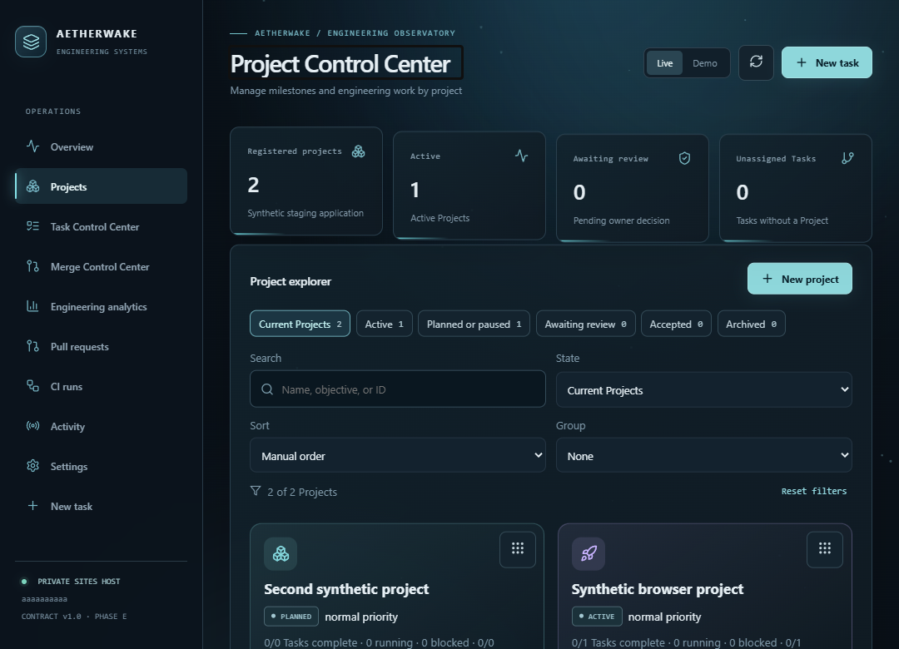

# Engineering Command Core

Engineering Command Core gives Aetherwake and Voyagewright owners one engineering platform for Projects, Tasks, milestones, worker execution, GitHub evidence, and protected integration. Each application has its own repository, authorization, data partition, worker credentials, and frontend theme.

Open **Projects** to organize initiatives, **Task Control Center** to manage the work and review its evidence, and **Merge Control Center** to inspect pull requests and their exact source revisions. **Activity** links work and connection issues to their source, and **Settings** stores owner preferences and displays observed configuration and health.



[Voyagewright mobile Settings](docs/screenshots/voyagewright-settings-mobile.png) · [Voyagewright Merge Control Center](docs/screenshots/voyagewright-merge-source.png)

The screenshots use named synthetic Projects and a synthetic pull request on the local staging engine. The existing Aetherwake Observatory stays the production service during review. [Phase 1B evidence and production gates](PHASE1B-SITES.md)

## Quick start

From `agent-system/observatory`, use Node.js 22 or newer.

```sh
npm ci
npm test
npm run test:sites
node --test ../../tests/agent-journal-export.test.mjs
npm run build
npx playwright install chromium
npm run test:workspace:e2e
```

Set `OBSERVATORY_ENGINE_E2E=1` to exercise the full Task browser workflow. Set `OBSERVATORY_BROWSER_EXECUTABLE` to use an installed Chromium-compatible browser. The staging browser test starts a local authenticated HTTP server and real SQLite partition while supplying synthetic provider responses.

## Guides

- [Architecture, permissions, and application isolation](docs/architecture.md)
- [Installation, application registration, workers, and ChatGPT setup](docs/deployment.md)
- [Projects, Tasks, milestones, scheduling, and dependencies](docs/engineering-workspaces.md)
- [Merge Control Center, GitHub, and CI](docs/integration.md)
- [Settings, configuration registry, and diagnostics](docs/settings.md)
- [Developer checks, troubleshooting, backups, and recovery](docs/operations.md)
- [Phase 1 review record](PHASE1.md), [Phase 1B Sites runbook](PHASE1B-SITES.md), and [original Observatory contract guide](agent-system/observatory/README.md)
