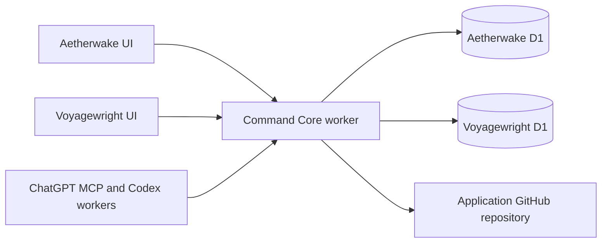

# Architecture and isolation

The React frontend calls same-origin HTTPS APIs. The [shared Worker composition root](../agent-system/observatory/sites/command-core.mjs) resolves the application from the registered origin and verifies caller identity before selecting an application binding. MCP requests name the application explicitly. Legacy compatibility is limited to the configured origin and routes.

An application partition pins its identifier, repository, and portfolio. The worker rejects shared bindings, reused secrets, unassigned identities, and partitions whose stored identity differs from configuration. Within a partition, operational records and preferences are scoped by authenticated owner and namespace. Verification namespaces support isolated acceptance checks. Project order and settings use optimistic version checks so stale tabs receive a conflict.

The Task Engine controls leases, scheduling, and dependency eligibility. Project data links existing Tasks to milestones and provides scoped projections. GitHub detail and overview routes project observed provider facts. Integration dispatch and landed-source verification use the existing protected engine. Separate write credentials and exact-source approval are enforced server-side. Browser mutations require authenticated same-origin JSON requests.

Command Core owns engineering records, execution state, and owner controls. Aerynth and Vela own AI reasoning, memory, provider routing, and adaptive execution. The staging installation and production migration have independent qualification evidence. [Phase 1B runbook](../PHASE1B-SITES.md)
